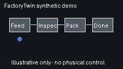

# FactoryTwin

**A software-only industrial production-line digital twin / smart-factory simulation prototype.**

> **Status:** v0.1.0 pre-alpha research/demo software release. All equipment, signals, workpieces, quality outcomes and faults are synthetic. **FactoryTwin is not a PLC, SCADA system, wire-compatible OPC UA server, hardware controller, safety system, or validated physical digital twin.**



## What you can run today

- Deterministic discrete-tick production lines with a strict configurable linear blueprint (1–32 stations).
- Workpiece genealogy with per-station visits and deterministic `GOOD`, `SCRAP`, and **same-station** `REWORK` scenarios.
- Workpiece conservation, single-slot backpressure, configurable productive cycle ticks, and replayable synthetic events.
- `RUNNING` / `PAUSED` / `FAULT` line semantics plus independent multi-station fault latches.
- Trace compatibility for legacy `trace.v1` / `trace.v2`, quality `trace.v3`, and multi-fault `trace.v4`.
- Optional local SQLite persistence with migration/recovery tests; default in-memory mode still works.
- Additive production metrics and OEE reporting with explicit planned-time/ideal-cycle inputs; OEE is disabled when those inputs are not defined.
- Local SSE snapshot streaming with reconnect/resync and ordinary snapshot polling as fallback.
- Responsive accessible 2D factory-floor dashboard with a read-only workpiece genealogy inspector.
- Optional **in-process OPC-UA-style simulator adapter** for typed synthetic nodes and validated methods. It opens no industrial protocol socket and controls no physical equipment.
- Python 3.11+ standard-library runtime for the simulator and server; no Docker, cloud account, or industrial hardware required.

## Quick start

From a source checkout:

```bash
python -m factorytwin
# configurable line:
python -m factorytwin --blueprint config/assembly_line.json

# open http://127.0.0.1:8766
```

The HTTP server binds to `127.0.0.1` only.

## Install v0.1.0 from a trusted source checkout

FactoryTwin v0.1.0 is an approved repository release. No PyPI publication is claimed for this release. To exercise the same install path used by CI, install from a trusted checkout of the v0.1.0 source:

```bash
python -m pip install --no-deps .
factorytwin
```

The package has no declared runtime dependencies. CI additionally builds a wheel and installs it into an isolated virtual environment from outside the repository checkout.

Run the complete test suite:

```bash
python -m unittest discover -s tests -v
```

`GET /api/snapshot` intentionally advances one observation tick. Paused/faulted lines still advance observation time but do no productive work.

## Python API compatibility

For ordinary simulator code, prefer the package-root import:

```python
from factorytwin import ProductionLine
```

The exact supported package-root exports and the historical `factorytwin.sim` compatibility facade are documented in [`docs/PUBLIC_API.md`](docs/PUBLIC_API.md) and locked by regression tests.

## Useful demo paths

- Browser dashboard: `http://127.0.0.1:8766/`
- Snapshot: `GET /api/snapshot`
- Controls: `POST /api/control`
- Read-only workpiece genealogy: `GET /api/workpieces/<WP-ID>`
- Read-only SSE stream: `GET /api/stream`
- Health: `GET /api/health`

See [`docs/DEMO.md`](docs/DEMO.md) for a reproducible walkthrough.

## Architecture map

```text
Validated blueprint + optional synthetic scenarios
                    |
                    v
        deterministic simulation core
   state / workpieces / faults / genealogy
                    |
        +-----------+------------+
        |                        |
        v                        v
 deterministic traces      optional SQLite
 v1/v2/v3/v4 replay        local persistence
        |                        |
        +-----------+------------+
                    |
                    v
       snapshot / genealogy / metrics
                    |
          +---------+----------+
          |                    |
          v                    v
     loopback REST          local SSE
          |                    |
          +---------+----------+
                    |
                    v
        accessible 2D browser UI

Optional boundary: in-process OPC-UA-style simulator mock
(no OPC UA wire server, no fieldbus, no physical device control)
```

Core modules include:

- `factorytwin/engine.py` — deterministic base engine core.
- `factorytwin/sim.py` — stable public simulator compatibility facade.
- `factorytwin/runtime.py` — explicit composed runtime used by the public `ProductionLine`.
- `factorytwin/blueprint.py` — strict local JSON linear-route validation.
- `factorytwin/genealogy.py` / `quality.py` — genealogy and deterministic quality semantics.
- `factorytwin/persistence.py` — optional local SQLite journals, migrations, and recovery.
- `factorytwin/metrics.py` — synthetic production metrics/OEE definitions.
- `factorytwin/streaming.py` — local SSE transport/resync behavior.
- `factorytwin/faults.py` / `fault_persistence.py` — multi-station fault model and recovery integration.
- `factorytwin/opcua_sim.py` — socket-free OPC-UA-style simulator adapter.
- `factorytwin/benchmark.py` — informational synthetic software benchmark reporter.
- `web/index.html` — zero-build accessible 2D dashboard.
- `TODO.md` — source task tracker.

For the design narrative and boundaries, see [`docs/ARCHITECTURE.md`](docs/ARCHITECTURE.md), [`docs/ARCHITECTURE_BLOG.md`](docs/ARCHITECTURE_BLOG.md), and [`docs/PUBLIC_API.md`](docs/PUBLIC_API.md).

## Quality and rework boundary

A configured `REWORK` result repeats the current station's processing cycle while preserving the workpiece identity. It does **not** route a workpiece backward through the station graph. The blueprint remains a single connected acyclic linear route. Physical-loop rework, branching, merging, queues, and generalized routing remain future design work.

## Metrics boundary

FactoryTwin does not invent an OEE value when planned observation time or ideal-cycle assumptions are missing. Metrics are derived from synthetic simulation data and are not evidence of real equipment performance.

## Protocol boundary

The optional OPC-UA-style adapter is an in-process software mock intended to exercise namespace/method semantics. It is **not** a wire-compatible OPC UA server, does not listen on an OPC UA endpoint, and must not be represented as a plant integration.

## Validation and release boundary

Software correctness validation, synthetic performance reporting, version policy, and the release checklist are documented separately:

- [`docs/VALIDATION.md`](docs/VALIDATION.md) — bounded deterministic soak/recovery validation.
- [`docs/PERFORMANCE.md`](docs/PERFORMANCE.md) — environment-dependent software benchmark reporting; no real-time threshold.
- [`docs/RELEASES.md`](docs/RELEASES.md) — versioning and approval policy.
- [`docs/RELEASE_CHECKLIST.md`](docs/RELEASE_CHECKLIST.md) — automated gates and recorded v0.1.0 approval decisions.

The v0.1.0 repository release was explicitly approved on 2026-10-20. Future main promotions, tags/releases, package-registry publication, and physical integration work each require their own explicit approval. No package-registry publication is part of v0.1.0.

## Safety

FactoryTwin must never be used as an industrial control or safety system. The local control API is unauthenticated because the server binds to `127.0.0.1`; do not expose it to untrusted networks or connect it to physical actuators.

## Demo and project story

- [`docs/DEMO.md`](docs/DEMO.md) — reproducible local demo sequence and synthetic GIF notes.
- [`docs/ARCHITECTURE_BLOG.md`](docs/ARCHITECTURE_BLOG.md) — how the project evolved from a four-station prototype to the current local software-only simulation platform.
- [`docs/assets/factorytwin-demo.gif`](docs/assets/factorytwin-demo.gif) — illustrative synthetic animation; not a recording of a physical plant.

MIT licensed. See `LICENSE` and `CONTRIBUTING.md`.
